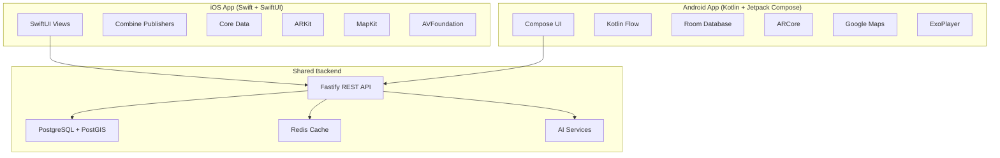

# EgyTour - Native Implementation Plan (iOS + Android)

## 🎯 Executive Decision: Native Development

**Rationale for Native Choice:**
- ✅ **Maximum AR Performance**: Full access to ARKit (iOS) and ARCore (Android)
- ✅ **Optimal Maps Integration**: Native MapKit and Google Maps with best performance
- ✅ **No Framework Limitations**: Direct access to latest platform APIs
- ✅ **Future-Proof**: No dependency on third-party frameworks
- ✅ **Platform-Specific Excellence**: Best-in-class UX for each platform

**Trade-offs Accepted:**
- ⚠️ Higher development cost (2 teams)
- ⚠️ Longer timeline (6 months vs 3 months)
- ⚠️ Dual maintenance burden

**Mitigation Strategy:**
- ✅ Shared backend API (single source of truth)
- ✅ Shared design system (consistent UX)
- ✅ Parallel development (iOS + Android simultaneously)
- ✅ Code sharing where possible (business logic in backend)

---

## 📐 Architecture Overview



---

## 🍎 iOS Implementation (Swift + SwiftUI)

### Project Structure

```
Egytour-iOS/
├── Egytour/
│   ├── App/
│   │   ├── EgytourApp.swift
│   │   └── AppDelegate.swift
│   ├── Features/
│   │   ├── Auth/
│   │   │   ├── Views/
│   │   │   │   ├── LoginView.swift
│   │   │   │   └── RegisterView.swift
│   │   │   ├── ViewModels/
│   │   │   │   └── AuthViewModel.swift
│   │   │   └── Models/
│   │   │       └── User.swift
│   │   ├── Explore/
│   │   │   ├── Views/
│   │   │   │   ├── ExploreView.swift
│   │   │   │   ├── MapView.swift
│   │   │   │   └── SiteCardView.swift
│   │   │   ├── ViewModels/
│   │   │   │   └── ExploreViewModel.swift
│   │   │   └── Models/
│   │   │       ├── Site.swift
│   │   │       └── POI.swift
│   │   ├── POIDetail/
│   │   │   ├── Views/
│   │   │   │   ├── POIDetailView.swift
│   │   │   │   ├── AudioPlayerView.swift
│   │   │   │   └── ARPreviewView.swift
│   │   │   └── ViewModels/
│   │   │       └── POIDetailViewModel.swift
│   │   ├── AR/
│   │   │   ├── Views/
│   │   │   │   └── ARNavigationView.swift
│   │   │   ├── ViewModels/
│   │   │   │   └── ARViewModel.swift
│   │   │   └── Components/
│   │   │       ├── ARWayfindingNode.swift
│   │   │       └── ARReconstructionNode.swift
│   │   ├── Itinerary/
│   │   │   ├── Views/
│   │   │   │   ├── ItineraryListView.swift
│   │   │   │   └── ItineraryDetailView.swift
│   │   │   └── ViewModels/
│   │   │       └── ItineraryViewModel.swift
│   │   └── Downloads/
│   │       ├── Views/
│   │       │   └── DownloadManagerView.swift
│   │       └── ViewModels/
│   │           └── DownloadViewModel.swift
│   ├── Services/
│   │   ├── NetworkService.swift
│   │   ├── LocationService.swift
│   │   ├── AudioService.swift
│   │   ├── ARService.swift
│   │   ├── DownloadService.swift
│   │   └── PersistenceService.swift
│   ├── Core/
│   │   ├── Extensions/
│   │   ├── Utilities/
│   │   └── Constants/
│   │       ├── Colors.swift
│   │       ├── Typography.swift
│   │       └── Config.swift
│   └── Resources/
│       ├── Assets.xcassets/
│       ├── Fonts/
│       └── Localizations/
├── EgytourTests/
└── EgytourUITests/
```

### Key Technologies

```swift
// iOS Tech Stack
- Language: Swift 5.9+
- UI Framework: SwiftUI 5.0
- Reactive: Combine
- Persistence: Core Data + FileManager
- Maps: MapKit
- AR: ARKit 6.0
- Audio: AVFoundation
- Networking: URLSession + Combine
- Location: CoreLocation
- Payments: StoreKit 2
```

### Design System Implementation

```swift
// Core/Constants/Colors.swift
import SwiftUI

extension Color {
    // Primary: Pharaoh's Gold
    static let primaryGold = Color(hex: "E6A800")
    static let primaryGold50 = Color(hex: "FFF9E6")
    static let primaryGold900 = Color(hex: "805C00")
    
    // Secondary: Nile Blue
    static let nileBlue = Color(hex: "0095C4")
    static let nileBlue50 = Color(hex: "E6F4F9")
    
    // Accent: Papyrus Orange
    static let papyrusOrange = Color(hex: "E67E22")
    
    // Dark Mode
    static let bgPrimary = Color(hex: "0D0B09")
    static let bgSecondary = Color(hex: "1A1714")
    static let textPrimary = Color(hex: "FAFAF5")
    static let textSecondary = Color(hex: "B8B5AD")
}

// Core/Constants/Typography.swift
extension Font {
    static let displayLarge = Font.custom("PlayfairDisplay-Bold", size: 48)
    static let displayMedium = Font.custom("PlayfairDisplay-SemiBold", size: 36)
    static let siteName = Font.custom("PlayfairDisplay-SemiBold", size: 28)
    static let poiTitle = Font.custom("Inter-SemiBold", size: 20)
    static let bodyText = Font.custom("Inter-Regular", size: 16)
    static let caption = Font.custom("Inter-Medium", size: 12)
}
```

### Location-Based Audio Trigger

```swift
// Services/LocationService.swift
import CoreLocation
import Combine

class LocationService: NSObject, ObservableObject {
    @Published var currentLocation: CLLocation?
    @Published var nearbyPOIs: [POI] = []
    
    private let locationManager = CLLocationManager()
    private var cancellables = Set<AnyCancellable>()
    
    override init() {
        super.init()
        setupLocationManager()
    }
    
    private func setupLocationManager() {
        locationManager.delegate = self
        locationManager.desiredAccuracy = kCLLocationAccuracyBest
        locationManager.distanceFilter = 10 // Update every 10 meters
        locationManager.allowsBackgroundLocationUpdates = true
        locationManager.pausesLocationUpdatesAutomatically = false
        
        // Request permissions
        locationManager.requestWhenInUseAuthorization()
        locationManager.requestAlwaysAuthorization()
    }
    
    func startTracking() {
        locationManager.startUpdatingLocation()
    }
    
    func stopTracking() {
        locationManager.stopUpdatingLocation()
    }
    
    private func checkProximityToPOIs(location: CLLocation) {
        // Fetch POIs from local database or API
        let pois = PersistenceService.shared.fetchNearbyPOIs(location: location)
        
        for poi in pois {
            let poiLocation = CLLocation(
                latitude: poi.coordinates.latitude,
                longitude: poi.coordinates.longitude
            )
            
            let distance = location.distance(from: poiLocation)
            
            // Check if within trigger radius
            if distance <= Double(poi.triggerRadiusMeters) {
                // Check debounce (don't re-trigger within 10 minutes)
                if shouldTriggerAudio(for: poi) {
                    triggerAudio(for: poi)
                }
            }
        }
    }
    
    private func shouldTriggerAudio(for poi: POI) -> Bool {
        let lastTrigger = UserDefaults.standard.object(forKey: "lastTrigger_\(poi.id)") as? Date
        
        guard let lastTrigger = lastTrigger else { return true }
        
        let tenMinutesAgo = Date().addingTimeInterval(-10 * 60)
        return lastTrigger < tenMinutesAgo
    }
    
    private func triggerAudio(for poi: POI) {
        AudioService.shared.playAudio(for: poi)
        UserDefaults.standard.set(Date(), forKey: "lastTrigger_\(poi.id)")
        
        // Show notification
        NotificationService.shared.showPOINotification(poi: poi)
    }
}

extension LocationService: CLLocationManagerDelegate {
    func locationManager(_ manager: CLLocationManager, didUpdateLocations locations: [CLLocation]) {
        guard let location = locations.last else { return }
        currentLocation = location
        checkProximityToPOIs(location: location)
    }
}
```

### ARKit Implementation

```swift
// Features/AR/Views/ARNavigationView.swift
import SwiftUI
import ARKit
import RealityKit

struct ARNavigationView: View {
    @StateObject private var viewModel = ARViewModel()
    
    var body: some View {
        ZStack {
            ARViewContainer(viewModel: viewModel)
                .edgesIgnoringSafeArea(.all)
            
            VStack {
                // AR Overlay UI
                HStack {
                    VStack(alignment: .leading, spacing: 8) {
                        Text(viewModel.destinationPOI?.name ?? "")
                            .font(.siteName)
                            .foregroundColor(.white)
                            .shadow(radius: 10)
                        
                        HStack {
                            Image(systemName: "location.fill")
                            Text("\(Int(viewModel.distanceToDestination))m away")
                                .font(.caption)
                        }
                        .foregroundColor(.primaryGold)
                    }
                    Spacer()
                }
                .padding()
                .background(
                    LinearGradient(
                        colors: [.black.opacity(0.6), .clear],
                        startPoint: .top,
                        endPoint: .bottom
                    )
                )
                
                Spacer()
                
                // Controls
                HStack(spacing: 20) {
                    Button(action: { viewModel.toggleARMode() }) {
                        Image(systemName: viewModel.isARActive ? "camera.fill" : "map.fill")
                            .font(.title2)
                            .foregroundColor(.white)
                            .frame(width: 60, height: 60)
                            .background(Color.primaryGold)
                            .clipShape(Circle())
                    }
                }
                .padding(.bottom, 40)
            }
        }
    }
}

struct ARViewContainer: UIViewRepresentable {
    @ObservedObject var viewModel: ARViewModel
    
    func makeUIView(context: Context) -> ARView {
        let arView = ARView(frame: .zero)
        
        // Configure AR session
        let config = ARWorldTrackingConfiguration()
        config.planeDetection = [.horizontal]
        config.worldAlignment = .gravityAndHeading
        
        arView.session.run(config)
        
        // Add AR content
        viewModel.setupARScene(arView: arView)
        
        return arView
    }
    
    func updateUIView(_ uiView: ARView, context: Context) {
        viewModel.updateARContent(arView: uiView)
    }
}

// Features/AR/ViewModels/ARViewModel.swift
class ARViewModel: ObservableObject {
    @Published var destinationPOI: POI?
    @Published var distanceToDestination: Double = 0
    @Published var isARActive = true
    
    private var arView: ARView?
    private var directionAnchor: AnchorEntity?
    
    func setupARScene(arView: ARView) {
        self.arView = arView
        
        // Create direction arrow
        let arrowEntity = createDirectionArrow()
        
        // Anchor at 2 meters in front
        let anchor = AnchorEntity(world: [0, 0, -2])
        anchor.addChild(arrowEntity)
        
        arView.scene.addAnchor(anchor)
        self.directionAnchor = anchor
    }
    
    func updateARContent(arView: ARView) {
        guard let destination = destinationPOI,
              let userLocation = LocationService.shared.currentLocation else { return }
        
        // Calculate bearing to destination
        let bearing = calculateBearing(
            from: userLocation.coordinate,
            to: destination.coordinates
        )
        
        // Rotate arrow to point at destination
        directionAnchor?.transform.rotation = simd_quatf(
            angle: Float(bearing),
            axis: [0, 1, 0]
        )
        
        // Update distance
        let destLocation = CLLocation(
            latitude: destination.coordinates.latitude,
            longitude: destination.coordinates.longitude
        )
        distanceToDestination = userLocation.distance(from: destLocation)
    }
    
    private func createDirectionArrow() -> ModelEntity {
        // Create golden arrow mesh
        let mesh = MeshResource.generateBox(size: [0.1, 0.1, 0.5])
        let material = SimpleMaterial(color: UIColor(Color.primaryGold), isMetallic: true)
        let arrow = ModelEntity(mesh: mesh, materials: [material])
        
        // Add pulsing animation
        var transform = arrow.transform
        transform.scale = [1.2, 1.2, 1.2]
        arrow.move(to: transform, relativeTo: arrow, duration: 0.5, timingFunction: .easeInOut)
        
        return arrow
    }
    
    private func calculateBearing(from: CLLocationCoordinate2D, to: CLLocationCoordinate2D) -> Double {
        let lat1 = from.latitude.degreesToRadians
        let lon1 = from.longitude.degreesToRadians
        let lat2 = to.latitude.degreesToRadians
        let lon2 = to.longitude.degreesToRadians
        
        let dLon = lon2 - lon1
        let y = sin(dLon) * cos(lat2)
        let x = cos(lat1) * sin(lat2) - sin(lat1) * cos(lat2) * cos(dLon)
        let bearing = atan2(y, x)
        
        return bearing.radiansToDegrees
    }
}
```

### MapKit Integration

```swift
// Features/Explore/Views/MapView.swift
import SwiftUI
import MapKit

struct ExploreMapView: View {
    @StateObject private var viewModel = ExploreViewModel()
    @State private var region = MKCoordinateRegion(
        center: CLLocationCoordinate2D(latitude: 29.9792, longitude: 31.1342), // Giza
        span: MKCoordinateSpan(latitudeDelta: 0.1, longitudeDelta: 0.1)
    )
    
    var body: some View {
        ZStack {
            Map(coordinateRegion: $region, annotationItems: viewModel.pois) { poi in
                MapAnnotation(coordinate: poi.coordinates) {
                    POIMarker(poi: poi)
                        .onTapGesture {
                            viewModel.selectPOI(poi)
                        }
                }
            }
            .edgesIgnoringSafeArea(.all)
            
            // Bottom sheet with POI cards
            VStack {
                Spacer()
                
                ScrollView(.horizontal, showsIndicators: false) {
                    HStack(spacing: 16) {
                        ForEach(viewModel.nearbyPOIs) { poi in
                            POICardView(poi: poi)
                                .frame(width: 300)
                        }
                    }
                    .padding(.horizontal)
                }
                .frame(height: 200)
                .background(
                    LinearGradient(
                        colors: [.clear, .bgPrimary.opacity(0.95)],
                        startPoint: .top,
                        endPoint: .bottom
                    )
                )
            }
        }
    }
}

struct POIMarker: View {
    let poi: POI
    @State private var isPulsing = false
    
    var body: some View {
        ZStack {
            // Pulsing ring
            Circle()
                .fill(Color.primaryGold.opacity(0.3))
                .frame(width: 40, height: 40)
                .scaleEffect(isPulsing ? 1.5 : 1.0)
                .opacity(isPulsing ? 0 : 1)
                .animation(
                    Animation.easeOut(duration: 1.5).repeatForever(autoreverses: false),
                    value: isPulsing
                )
            
            // Marker
            Circle()
                .fill(Color.primaryGold)
                .frame(width: 20, height: 20)
                .overlay(
                    Circle()
                        .stroke(Color.white, lineWidth: 2)
                )
                .shadow(color: .primaryGold.opacity(0.5), radius: 10)
        }
        .onAppear {
            isPulsing = true
        }
    }
}
```

---

## 🤖 Android Implementation (Kotlin + Jetpack Compose)

### Project Structure

```
egytour-android/
├── app/
│   ├── src/
│   │   ├── main/
│   │   │   ├── java/com/egytour/
│   │   │   │   ├── EgytourApplication.kt
│   │   │   │   ├── MainActivity.kt
│   │   │   │   ├── features/
│   │   │   │   │   ├── auth/
│   │   │   │   │   │   ├── ui/
│   │   │   │   │   │   │   ├── LoginScreen.kt
│   │   │   │   │   │   │   └── RegisterScreen.kt
│   │   │   │   │   │   ├── viewmodel/
│   │   │   │   │   │   │   └── AuthViewModel.kt
│   │   │   │   │   │   └── data/
│   │   │   │   │   │       └── User.kt
│   │   │   │   │   ├── explore/
│   │   │   │   │   │   ├── ui/
│   │   │   │   │   │   │   ├── ExploreScreen.kt
│   │   │   │   │   │   │   ├── MapScreen.kt
│   │   │   │   │   │   │   └── SiteCard.kt
│   │   │   │   │   │   ├── viewmodel/
│   │   │   │   │   │   │   └── ExploreViewModel.kt
│   │   │   │   │   │   └── data/
│   │   │   │   │   │       ├── Site.kt
│   │   │   │   │   │       └── POI.kt
│   │   │   │   │   ├── poi/
│   │   │   │   │   │   ├── ui/
│   │   │   │   │   │   │   ├── POIDetailScreen.kt
│   │   │   │   │   │   │   └── AudioPlayer.kt
│   │   │   │   │   │   └── viewmodel/
│   │   │   │   │   │       └── POIViewModel.kt
│   │   │   │   │   ├── ar/
│   │   │   │   │   │   ├── ui/
│   │   │   │   │   │   │   └── ARNavigationScreen.kt
│   │   │   │   │   │   └── viewmodel/
│   │   │   │   │   │       └── ARViewModel.kt
│   │   │   │   │   └── downloads/
│   │   │   │   │       ├── ui/
│   │   │   │   │       │   └── DownloadManagerScreen.kt
│   │   │   │   │       └── viewmodel/
│   │   │   │   │           └── DownloadViewModel.kt
│   │   │   │   ├── services/
│   │   │   │   │   ├── NetworkService.kt
│   │   │   │   │   ├── LocationService.kt
│   │   │   │   │   ├── AudioService.kt
│   │   │   │   │   ├── ARService.kt
│   │   │   │   │   └── DownloadService.kt
│   │   │   │   ├── core/
│   │   │   │   │   ├── theme/
│   │   │   │   │   │   ├── Color.kt
│   │   │   │   │   │   ├── Type.kt
│   │   │   │   │   │   └── Theme.kt
│   │   │   │   │   ├── utils/
│   │   │   │   │   └── constants/
│   │   │   │   └── data/
│   │   │   │       ├── local/
│   │   │   │       │   └── EgytourDatabase.kt
│   │   │   │       ├── remote/
│   │   │   │       │   └── ApiService.kt
│   │   │   │       └── repository/
│   │   │   └── res/
│   │   └── test/
│   └── build.gradle.kts
└── build.gradle.kts
```

### Key Technologies

```kotlin
// Android Tech Stack
- Language: Kotlin 1.9+
- UI Framework: Jetpack Compose
- Reactive: Kotlin Flow + Coroutines
- Persistence: Room Database
- Maps: Google Maps SDK
- AR: ARCore
- Audio: ExoPlayer
- Networking: Retrofit + OkHttp
- Location: Fused Location Provider
- DI: Hilt
- Payments: Google Play Billing
```

### Design System

```kotlin
// core/theme/Color.kt
package com.egytour.core.theme

import androidx.compose.ui.graphics.Color

object EgytourColors {
    // Primary: Pharaoh's Gold
    val PrimaryGold = Color(0xFFE6A800)
    val PrimaryGold50 = Color(0xFFFFF9E6)
    val PrimaryGold900 = Color(0xFF805C00)
    
    // Secondary: Nile Blue
    val NileBlue = Color(0xFF0095C4)
    val NileBlue50 = Color(0xFFE6F4F9)
    
    // Accent: Papyrus Orange
    val PapyrusOrange = Color(0xFFE67E22)
    
    // Dark Mode
    val BgPrimary = Color(0xFF0D0B09)
    val BgSecondary = Color(0xFF1A1714)
    val TextPrimary = Color(0xFFFAFAF5)
    val TextSecondary = Color(0xFFB8B5AD)
}

// core/theme/Type.kt
import androidx.compose.material3.Typography
import androidx.compose.ui.text.TextStyle
import androidx.compose.ui.text.font.Font
import androidx.compose.ui.text.font.FontFamily
import androidx.compose.ui.text.font.FontWeight
import androidx.compose.ui.unit.sp

val PlayfairDisplay = FontFamily(
    Font(R.font.playfair_display_regular),
    Font(R.font.playfair_display_semibold, FontWeight.SemiBold),
    Font(R.font.playfair_display_bold, FontWeight.Bold)
)

val Inter = FontFamily(
    Font(R.font.inter_regular),
    Font(R.font.inter_medium, FontWeight.Medium),
    Font(R.font.inter_semibold, FontWeight.SemiBold)
)

val EgytourTypography = Typography(
    displayLarge = TextStyle(
        fontFamily = PlayfairDisplay,
        fontWeight = FontWeight.Bold,
        fontSize = 48.sp
    ),
    titleLarge = TextStyle(
        fontFamily = PlayfairDisplay,
        fontWeight = FontWeight.SemiBold,
        fontSize = 28.sp
    ),
    bodyLarge = TextStyle(
        fontFamily = Inter,
        fontWeight = FontWeight.Normal,
        fontSize = 16.sp
    )
)
```

### Location Service (Android)

```kotlin
// services/LocationService.kt
package com.egytour.services

import android.annotation.SuppressLint
import android.content.Context
import android.location.Location
import com.google.android.gms.location.*
import kotlinx.coroutines.channels.awaitClose
import kotlinx.coroutines.flow.Flow
import kotlinx.coroutines.flow.callbackFlow
import javax.inject.Inject
import javax.inject.Singleton

@Singleton
class LocationService @Inject constructor(
    private val context: Context,
    private val audioService: AudioService
) {
    private val fusedLocationClient = LocationServices.getFusedLocationProviderClient(context)
    private val lastTriggered = mutableMapOf<String, Long>()
    
    @SuppressLint("MissingPermission")
    fun getLocationUpdates(): Flow<Location> = callbackFlow {
        val locationRequest = LocationRequest.Builder(
            Priority.PRIORITY_HIGH_ACCURACY,
            10000L // 10 seconds
        ).apply {
            setMinUpdateDistanceMeters(10f) // 10 meters
            setWaitForAccurateLocation(true)
        }.build()
        
        val locationCallback = object : LocationCallback() {
            override fun onLocationResult(result: LocationResult) {
                result.lastLocation?.let { location ->
                    trySend(location)
                    checkProximityToPOIs(location)
                }
            }
        }
        
        fusedLocationClient.requestLocationUpdates(
            locationRequest,
            locationCallback,
            context.mainLooper
        )
        
        awaitClose {
            fusedLocationClient.removeLocationUpdates(locationCallback)
        }
    }
    
    private fun checkProximityToPOIs(location: Location) {
        // Fetch nearby POIs from local database
        val pois = database.poiDao().getNearbyPOIs(location.latitude, location.longitude)
        
        for (poi in pois) {
            val poiLocation = Location("").apply {
                latitude = poi.coordinates.latitude
                longitude = poi.coordinates.longitude
            }
            
            val distance = location.distanceTo(poiLocation)
            
            if (distance <= poi.triggerRadiusMeters) {
                if (shouldTriggerAudio(poi.id)) {
                    audioService.playAudio(poi)
                    lastTriggered[poi.id] = System.currentTimeMillis()
                }
            }
        }
    }
    
    private fun shouldTriggerAudio(poiId: String): Boolean {
        val lastTrigger = lastTriggered[poiId] ?: return true
        val tenMinutesAgo = System.currentTimeMillis() - (10 * 60 * 1000)
        return lastTrigger < tenMinutesAgo
    }
}
```

### ARCore Implementation

```kotlin
// features/ar/ui/ARNavigationScreen.kt
package com.egytour.features.ar.ui

import androidx.compose.runtime.*
import androidx.compose.ui.platform.LocalContext
import androidx.compose.ui.viewinterop.AndroidView
import com.google.ar.core.*
import com.google.ar.sceneform.AnchorNode
import com.google.ar.sceneform.rendering.ModelRenderable
import com.google.ar.sceneform.ux.ArFragment

@Composable
fun ARNavigationScreen(
    destinationPOI: POI,
    viewModel: ARViewModel = hiltViewModel()
) {
    val context = LocalContext.current
    var arFragment by remember { mutableStateOf<ArFragment?>(null) }
    
    DisposableEffect(Unit) {
        onDispose {
            arFragment?.arSceneView?.session?.close()
        }
    }
    
    Box(modifier = Modifier.fillMaxSize()) {
        AndroidView(
            factory = { ctx ->
                ArFragment().also { fragment ->
                    arFragment = fragment
                    setupARScene(fragment, destinationPOI, viewModel)
                }
            }
        )
        
        // AR Overlay UI
        Column(
            modifier = Modifier
                .fillMaxSize()
                .padding(16.dp)
        ) {
            // Destination info
            Card(
                modifier = Modifier.fillMaxWidth(),
                colors = CardDefaults.cardColors(
                    containerColor = Color.Black.copy(alpha = 0.6f)
                )
            ) {
                Column(modifier = Modifier.padding(16.dp)) {
                    Text(
                        text = destinationPOI.name,
                        style = MaterialTheme.typography.titleLarge,
                        color = Color.White
                    )
                    
                    Row(verticalAlignment = Alignment.CenterVertically) {
                        Icon(
                            imageVector = Icons.Default.LocationOn,
                            contentDescription = null,
                            tint = EgytourColors.PrimaryGold
                        )
                        Spacer(modifier = Modifier.width(8.dp))
                        Text(
                            text = "${viewModel.distanceToDestination.toInt()}m away",
                            style = MaterialTheme.typography.bodyMedium,
                            color = EgytourColors.PrimaryGold
                        )
                    }
                }
            }
            
            Spacer(modifier = Modifier.weight(1f))
            
            // Controls
            FloatingActionButton(
                onClick = { viewModel.toggleARMode() },
                containerColor = EgytourColors.PrimaryGold,
                modifier = Modifier.align(Alignment.CenterHorizontally)
            ) {
                Icon(
                    imageVector = if (viewModel.isARActive) 
                        Icons.Default.Camera else Icons.Default.Map,
                    contentDescription = "Toggle AR"
                )
            }
        }
    }
}

private fun setupARScene(
    arFragment: ArFragment,
    destination: POI,
    viewModel: ARViewModel
) {
    arFragment.arSceneView.scene.addOnUpdateListener { frameTime ->
        val frame = arFragment.arSceneView.arFrame ?: return@addOnUpdateListener
        
        // Update arrow direction
        updateARContent(arFragment, destination, viewModel)
    }
    
    // Create direction arrow
    ModelRenderable.builder()
        .setSource(context, R.raw.arrow_model)
        .build()
        .thenAccept { renderable ->
            val anchor = arFragment.arSceneView.session?.createAnchor(
                Pose.makeTranslation(0f, 0f, -2f)
            )
            
            val anchorNode = AnchorNode(anchor)
            anchorNode.renderable = renderable
            arFragment.arSceneView.scene.addChild(anchorNode)
        }
}
```

### Google Maps Integration

```kotlin
// features/explore/ui/MapScreen.kt
package com.egytour.features.explore.ui

import androidx.compose.runtime.*
import com.google.android.gms.maps.model.CameraPosition
import com.google.android.gms.maps.model.LatLng
import com.google.maps.android.compose.*

@Composable
fun ExploreMapScreen(
    viewModel: ExploreViewModel = hiltViewModel()
) {
    val pois by viewModel.pois.collectAsState()
    val cameraPositionState = rememberCameraPositionState {
        position = CameraPosition.fromLatLngZoom(
            LatLng(29.9792, 31.1342), // Giza
            12f
        )
    }
    
    Box(modifier = Modifier.fillMaxSize()) {
        GoogleMap(
            modifier = Modifier.fillMaxSize(),
            cameraPositionState = cameraPositionState,
            properties = MapProperties(
                mapType = MapType.NORMAL,
                isMyLocationEnabled = true
            ),
            uiSettings = MapUiSettings(
                zoomControlsEnabled = false,
                myLocationButtonEnabled = true
            )
        ) {
            pois.forEach { poi ->
                POIMarker(
                    poi = poi,
                    onClick = { viewModel.selectPOI(poi) }
                )
            }
        }
        
        // Bottom sheet with POI cards
        LazyRow(
            modifier = Modifier
                .align(Alignment.BottomCenter)
                .fillMaxWidth()
                .height(200.dp)
                .background(
                    Brush.verticalGradient(
                        colors = listOf(Color.Transparent, EgytourColors.BgPrimary.copy(alpha = 0.95f))
                    )
                ),
            contentPadding = PaddingValues(16.dp),
            horizontalArrangement = Arrangement.spacedBy(16.dp)
        ) {
            items(pois) { poi ->
                POICard(
                    poi = poi,
                    modifier = Modifier.width(300.dp)
                )
            }
        }
    }
}

@Composable
fun POIMarker(
    poi: POI,
    onClick: () -> Unit
) {
    val position = LatLng(poi.coordinates.latitude, poi.coordinates.longitude)
    
    Marker(
        state = MarkerState(position = position),
        title = poi.name,
        onClick = {
            onClick()
            true
        },
        icon = BitmapDescriptorFactory.fromResource(R.drawable.poi_marker_gold)
    )
    
    // Pulsing circle
    Circle(
        center = position,
        radius = poi.triggerRadiusMeters.toDouble(),
        fillColor = EgytourColors.PrimaryGold.copy(alpha = 0.2f),
        strokeColor = EgytourColors.PrimaryGold,
        strokeWidth = 2f
    )
}
```

---

## 🔄 Code Sharing Strategy

### Shared Backend API

```typescript
// All business logic in backend
// Mobile apps are thin clients

// Example: Trip planning algorithm runs on server
POST /api/v1/itineraries/generate
{
  "duration_days": 5,
  "regions": ["cairo", "luxor"],
  "interests": ["ancient_history"]
}

// Response includes optimized itinerary
// No duplication of complex logic
```

### Shared Design Tokens

```json
// design-tokens.json (shared between iOS & Android)
{
  "colors": {
    "primary": {
      "gold": "#E6A800",
      "gold50": "#FFF9E6"
    }
  },
  "typography": {
    "display": {
      "family": "PlayfairDisplay",
      "size": 48
    }
  }
}
```

### Shared API Models

```kotlin
// Generate from OpenAPI spec
// Use same models on iOS (Swift) and Android (Kotlin)

// tools/generate-models.sh
swagger-codegen generate -i api-spec.yaml -l swift -o ios/Models
swagger-codegen generate -i api-spec.yaml -l kotlin -o android/app/src/main/java/models
```

---

## 📅 Development Timeline (6 Months)

### Month 1: Foundation

**Week 1-2: Setup & Infrastructure**
- ✅ iOS Xcode project setup
- ✅ Android Studio project setup
- ✅ Backend API skeleton
- ✅ Database schema + migrations
- ✅ CI/CD pipelines

**Week 3-4: Authentication & Core UI**
- ✅ iOS: Login/Register screens
- ✅ Android: Login/Register screens
- ✅ Backend: JWT auth
- ✅ Design system implementation

### Month 2: Maps & Location

**Week 5-6: Map Integration**
- ✅ iOS: MapKit implementation
- ✅ Android: Google Maps implementation
- ✅ POI markers and clustering
- ✅ User location tracking

**Week 7-8: Location-Based Audio**
- ✅ iOS: CoreLocation + AVFoundation
- ✅ Android: Fused Location + ExoPlayer
- ✅ Audio trigger system
- ✅ Background location tracking

### Month 3: AR Features

**Week 9-10: Basic AR**
- ✅ iOS: ARKit wayfinding
- ✅ Android: ARCore wayfinding
- ✅ Direction arrows
- ✅ Distance indicators

**Week 11-12: Advanced AR**
- ✅ iOS: 3D reconstructions
- ✅ Android: 3D reconstructions
- ✅ AR content management
- ✅ Performance optimization

### Month 4: Offline & Downloads

**Week 13-14: Download System**
- ✅ iOS: FileManager + Core Data
- ✅ Android: Room + File storage
- ✅ Download manager UI
- ✅ Content encryption

**Week 15-16: Offline Sync**
- ✅ Delta updates
- ✅ Conflict resolution
- ✅ Storage management
- ✅ Background sync

### Month 5: AI & Trip Planning

**Week 17-18: AI Q&A**
- ✅ Backend: RAG implementation
- ✅ iOS: Chat interface
- ✅ Android: Chat interface
- ✅ Voice input (STT)

**Week 19-20: Trip Planner**
- ✅ Backend: Optimization algorithm
- ✅ iOS: Itinerary UI
- ✅ Android: Itinerary UI
- ✅ Drag-to-reorder

### Month 6: Polish & Launch

**Week 21-22: Payments & Subscriptions**
- ✅ iOS: StoreKit 2
- ✅ Android: Google Play Billing
- ✅ Backend: Subscription management
- ✅ Receipt validation

**Week 23-24: Testing & Beta**
- ✅ iOS: TestFlight beta
- ✅ Android: Internal testing
- ✅ Bug fixes
- ✅ Performance optimization
- ✅ App Store submissions

---

## ✅ Quality Assurance

### Testing Strategy

```
Unit Tests:
- iOS: XCTest (ViewModels, Services)
- Android: JUnit + Mockito (ViewModels, Repositories)
- Target: 80% code coverage

UI Tests:
- iOS: XCUITest
- Android: Espresso + Compose Testing
- Critical user flows

Integration Tests:
- API contract tests
- Database migrations
- Offline sync scenarios

Performance Tests:
- AR frame rate (target: 60fps)
- Audio latency (target: <100ms)
- Map rendering (target: <2s)
- Battery drain (target: <5%/hour)
```

---

## 🚀 Deployment

### iOS Deployment

```bash
# TestFlight Beta
fastlane ios beta

# App Store Release
fastlane ios release
```

### Android Deployment

```bash
# Internal Testing
fastlane android internal

# Production Release
fastlane android production
```

---

## 💰 Cost Estimate (Native Path)

### Team (6 months)

```
- 2 iOS Developers: $144,000
- 2 Android Developers: $144,000
- 1 Backend Developer: $60,000
- 1 UI/UX Designer: $48,000
- 1 QA Engineer: $36,000
- 1 Egyptologist (part-time): $18,000
Total: $450,000
```

### Infrastructure (6 months)

```
- AWS (S3, CloudFront): $3,000
- Database (Supabase): $1,200
- Redis (Upstash): $600
- AI APIs: $6,000
- Apple Developer: $600
- Google Play: $150
Total: $11,550
```

### **TOTAL 6-MONTH COST: $461,550**

---

## 🎯 Success Metrics

### Technical KPIs
- ✅ AR frame rate: 60fps on flagship, 30fps on mid-range
- ✅ Map load time: <2s
- ✅ Audio trigger accuracy: >95%
- ✅ Crash rate: <1%
- ✅ App size: <150MB

### Product KPIs
- ✅ 50,000 downloads (Month 6)
- ✅ 2,000 paying users
- ✅ 4.5+ App Store rating
- ✅ 50% audio completion rate

---

## 📞 Next Steps

### Week 1 Actions

1. **Hire Team**
   - Post iOS developer positions
   - Post Android developer positions
   - Interview candidates

2. **Setup Infrastructure**
   - Create Apple Developer account
   - Create Google Play Console account
   - Setup Supabase database
   - Setup AWS S3

3. **Project Initialization**
   - Create iOS Xcode project
   - Create Android Studio project
   - Setup Git repositories
   - Configure CI/CD

4. **Design Handoff**
   - Export design tokens from Figma
   - Create component library
   - Document design system

---

## ✅ Conclusion

**Native development is the right choice for EgyTour given your requirements:**

- ✅ **Maximum AR Performance**: Full ARKit/ARCore capabilities
- ✅ **Optimal Maps**: Native MapKit and Google Maps
- ✅ **No Framework Limitations**: Direct platform access
- ✅ **Future-Proof**: Latest iOS/Android features

**The investment in native development will pay off through:**
- Superior AR experiences
- Better map performance
- Platform-specific polish
- Long-term maintainability

**Ready to proceed with native implementation!**

---

*This plan provides a complete roadmap for native iOS and Android development with shared backend architecture.*
