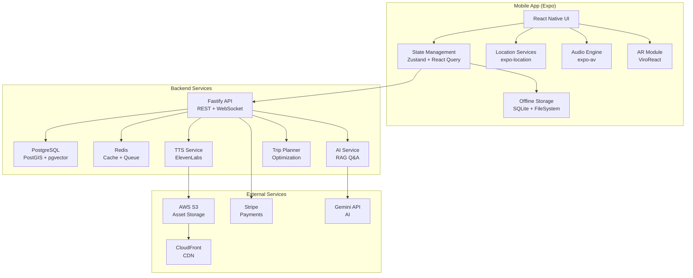

# EgyTour - Technical Implementation Plan

## 🎯 Overview

This document provides a detailed, actionable technical implementation plan for building EgyTour using **React Native + Expo**. This plan assumes the strategic decision to pivot from native development has been approved.

---

## 📐 System Architecture

### High-Level Architecture Diagram



---

## 🗂️ Project Structure

```
egytour/
├── apps/
│   ├── mobile/                       # Expo React Native app
│   ├── api/                          # Fastify backend
│   └── web/                          # Next.js marketing site
├── packages/
│   ├── db/                           # Database layer
│   ├── shared/                       # Shared types
│   └── validation/                   # Zod schemas
├── services/
│   ├── ai-guide/                     # RAG Q&A service
│   ├── tts-generator/                # Audio generation
│   └── trip-planner/                 # Itinerary optimization
└── content/                          # Content repository
```

---

## 🔧 Technology Stack

### Mobile App
- Expo SDK 50+
- React Native 0.73+
- Moti (animations)
- Mapbox GL (maps)
- ViroReact (AR)
- expo-av (audio)

### Backend
- Fastify (API)
- PostgreSQL + PostGIS + pgvector
- Redis + BullMQ
- Drizzle ORM

### AI/ML
- Google Gemini (Q&A)
- ElevenLabs (TTS)
- sentence-transformers (embeddings)

---

## 🗄️ Database Schema

### Core Tables

```typescript
// sites table
export const sites = pgTable('sites', {
  id: uuid('id').primaryKey().defaultRandom(),
  nameEn: text('name_en').notNull(),
  nameAr: text('name_ar').notNull(),
  nameFr: text('name_fr').notNull(),
  coordinates: geography('coordinates', { type: 'point' }).notNull(),
  region: text('region').notNull(),
  entryFee: jsonb('entry_fee'),
  contentVersion: text('content_version').default('1.0.0'),
});

// points_of_interest table
export const pointsOfInterest = pgTable('points_of_interest', {
  id: uuid('id').primaryKey().defaultRandom(),
  siteId: uuid('site_id').references(() => sites.id),
  nameEn: text('name_en').notNull(),
  coordinates: geography('coordinates', { type: 'point' }).notNull(),
  triggerRadiusMeters: integer('trigger_radius_meters').default(20),
  historicalPeriod: text('historical_period'),
  importanceRank: integer('importance_rank').default(5),
});

// audio_content table
export const audioContent = pgTable('audio_content', {
  id: uuid('id').primaryKey().defaultRandom(),
  poiId: uuid('poi_id').references(() => pointsOfInterest.id),
  languageCode: text('language_code').notNull(),
  expertiseLevel: text('expertise_level').notNull(),
  audioUrl: text('audio_url').notNull(),
  transcript: text('transcript').notNull(),
});
```

---

## 🔐 Security Implementation

### JWT Authentication

```typescript
// Access token: 15 minutes
// Refresh token: 7 days
export const generateTokens = (userId: string) => {
  const accessToken = jwt.sign({ userId }, { expiresIn: '15m' });
  const refreshToken = jwt.sign({ userId }, { expiresIn: '7d' });
  return { accessToken, refreshToken };
};
```

### Content Encryption

```typescript
// AES-256-GCM for offline files
// Device-specific keys stored in Keychain/Keystore
export class ContentEncryption {
  static async encryptFile(data: ArrayBuffer): Promise<ArrayBuffer> {
    const key = await this.getDeviceKey();
    return await Crypto.encrypt(data, key);
  }
}
```

### Rate Limiting

```typescript
// AI Q&A: 10 req/min
// Search: 30 req/min
// Downloads: 100MB/hour
await fastify.register(rateLimit, {
  max: 100,
  timeWindow: '1 minute',
  redis: fastify.redis,
});
```

---

## 🎵 Audio Trigger System

```typescript
// Location-based audio playback
export const useAudioTrigger = (pois: POI[]) => {
  useEffect(() => {
    Location.startLocationUpdatesAsync(TASK_NAME, {
      accuracy: Location.Accuracy.Balanced,
      distanceInterval: 10,
    });
  }, []);
  
  // Check proximity and trigger audio
  for (const poi of pois) {
    const distance = haversineDistance(userLocation, poi.coordinates);
    if (distance <= poi.triggerRadiusMeters) {
      playAudio(poi.audioUrl);
    }
  }
};
```

---

## 📥 Offline Content Sync

```typescript
export class DownloadManager {
  static async downloadSite(siteId: string) {
    // 1. Fetch manifest
    const manifest = await fetchManifest(siteId);
    
    // 2. Download all assets
    for (const file of manifest.files) {
      await FileSystem.downloadAsync(file.url, localPath);
      
      // 3. Verify checksum
      const checksum = await calculateChecksum(localPath);
      if (checksum !== file.checksum) throw new Error('Checksum mismatch');
    }
    
    // 4. Save manifest
    await saveManifest(siteId, manifest);
  }
}
```

---

## 🤖 AI Q&A (RAG)

```typescript
export class RAGService {
  async askQuestion(question: string, poiId?: string) {
    // 1. Generate embedding
    const embedding = await this.generateEmbedding(question);
    
    // 2. Vector similarity search
    const chunks = await db.execute(sql`
      SELECT content FROM knowledge_chunks
      WHERE poi_id = ${poiId}
      ORDER BY embedding <=> ${embedding}::vector
      LIMIT 5
    `);
    
    // 3. Generate answer with Gemini
    const context = chunks.map(c => c.content).join('\n\n');
    const answer = await gemini.generateContent({
      prompt: `Context: ${context}\n\nQuestion: ${question}`,
    });
    
    return { answer, sources: chunks };
  }
}
```

---

## 🚀 Deployment

### CI/CD Pipeline

```yaml
# GitHub Actions
- Test: pnpm test
- Build: pnpm build
- Deploy API: Railway
- Deploy Mobile: Expo EAS
```

### Infrastructure

- **Database**: Supabase (PostgreSQL + PostGIS + pgvector)
- **Cache**: Upstash Redis
- **Storage**: AWS S3 + CloudFront
- **API**: Railway
- **Mobile**: Expo EAS

---

## 📊 Monitoring

### Error Tracking

```typescript
Sentry.init({
  dsn: process.env.SENTRY_DSN,
  tracesSampleRate: 1.0,
});
```

### Analytics

```typescript
trackEvent('audio_played', { poiId, duration });
trackEvent('site_downloaded', { siteId, size });
trackEvent('ai_question_asked', { poiId });
```

---

## ✅ Testing

### Unit Tests (Vitest)

```typescript
it('should create site with valid coordinates', async () => {
  const site = await db.insert(sites).values({...});
  expect(site.nameEn).toBe('Giza Pyramids');
});
```

### Integration Tests (Supertest)

```typescript
it('GET /api/v1/sites should return sites', async () => {
  const response = await app.inject({ method: 'GET', url: '/api/v1/sites' });
  expect(response.statusCode).toBe(200);
});
```

### E2E Tests (Detox)

```typescript
it('should complete onboarding', async () => {
  await element(by.text('Start Your Journey')).tap();
  await expect(element(by.id('explore-tab'))).toBeVisible();
});
```

---

## 🎯 Week 1 Action Items

### Day 1-2: Project Setup
```bash
npx create-turbo@latest egytour
npx create-expo-app@latest apps/mobile
mkdir -p apps/api packages/db
```

### Day 3-4: Database
```sql
CREATE EXTENSION postgis;
CREATE EXTENSION vector;
-- Run migrations
-- Seed Giza data
```

### Day 5-7: Mobile Foundation
```typescript
// Setup Expo Router
// Implement design system
// Create Welcome/Login screens
// Test on simulators
```

---

## 📚 Resources

- [Expo Docs](https://docs.expo.dev/)
- [Drizzle ORM](https://orm.drizzle.team/)
- [Fastify](https://www.fastify.io/)
- [ViroReact](https://github.com/NativeVision/viro)
- [pgvector](https://github.com/pgvector/pgvector)

---

*This is a living document - update as the project evolves.*
